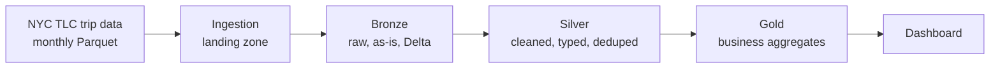

# NYC Taxi Lakehouse — Medallion Pipeline in Three Environments

An end-to-end data engineering project that ingests NYC TLC taxi trip data and processes it through a **Bronze → Silver → Gold** (medallion) architecture with PySpark and Delta Lake. The same pipeline is built three times — **locally**, on **Databricks Free Edition**, and on a **cloud trial** (Microsoft Fabric or GCP) — to show how the design carries across platforms.

> **Status:** 🚧 In progress — see [Progress](#progress)

---

## Why this project

- **Real-world data:** millions of NYC taxi trips per month, with real quality problems (negative fares, zero-distance trips, out-of-range timestamps).
- **Industry-standard design:** medallion architecture on Delta Lake, orchestrated and data-quality checked.
- **Portable by design:** one PySpark codebase running locally, on Databricks, and in the cloud, with the differences documented.

---

## Architecture



| Layer | Purpose | Key rules |
|---|---|---|
| **Landing** | Raw files exactly as downloaded | Partitioned by `yellow/yyyy/mm/` |
| **Bronze** | Replayable raw history in Delta | Append-only; adds `_ingested_at`, `_source_file` |
| **Silver** | Trustworthy, analysis-ready trips | Type casting, invalid-row filtering, dedupe, zone lookup join, `trip_duration_min` |
| **Gold** | Answers to business questions | Daily trips and revenue by borough, demand by hour, fare per mile, top routes |

---

## The three builds

| | Stage 1 — Local | Stage 2 — Databricks | Stage 3 — Cloud |
|---|---|---|---|
| **Compute** | Apache Spark + `delta-spark` | Databricks Free Edition (serverless) | Fabric notebooks / Dataproc Serverless |
| **Storage** | Local folders | Unity Catalog volumes + managed tables | OneLake / Cloud Storage |
| **Orchestration** | Apache Airflow (Docker) | Databricks Jobs | Fabric Data Factory / Cloud Workflows |
| **Reporting** | DuckDB + Metabase / Streamlit | Databricks SQL | Power BI / BigQuery |
| **Cost** | ₹0 | ₹0 | Free-trial credit |

What changed between environments, and why, is documented in [`docs/environment-comparison.md`](docs/environment-comparison.md).

---

## Repository structure

```
.
├── README.md
├── PROMPT.md                     # Instructions for an AI pair-programmer
├── requirements.txt
├── config/
│   └── pipeline.yaml             # Paths, months to process, source URLs
├── src/
│   ├── ingest/                   # Download raw files to landing
│   ├── bronze/
│   ├── silver/
│   ├── gold/
│   └── quality/                  # Row-count reconciliation + assertions
├── orchestration/
│   └── airflow/dags/             # Local DAG
├── databricks/                   # Stage 2 notebooks + job definition
├── cloud/                        # Stage 3 pipeline definitions
├── dashboard/
├── docs/
│   ├── environment-comparison.md
│   └── screenshots/
└── data/                         # Git-ignored: landing/, bronze/, silver/, gold/
```

---

## Getting started (Stage 1 — local)

### Prerequisites

- Python 3.10+
- Java (required by Spark — check the version your Spark release supports)
- Docker (for Airflow)

### Setup

```bash
git clone <this-repo>
cd <this-repo>
python -m venv .venv && source .venv/bin/activate   # Windows: .venv\Scripts\activate
pip install -r requirements.txt                      # pyspark, delta-spark, duckdb, ...
```

> `pyspark` and `delta-spark` versions must be compatible — check the Delta Lake release notes before pinning.

### Run the pipeline for one month

```bash
python -m src.ingest --year 2024 --month 1
python -m src.bronze --year 2024 --month 1
python -m src.silver --year 2024 --month 1
python -m src.gold
```

### Run with Airflow

```bash
cd orchestration/airflow
docker compose up -d
# Open the Airflow UI, enable the DAG, and backfill the months you want
```

---

## Data quality

Silver-layer rules and how many rows each removed (filled in after running):

| Rule | Rows dropped | % of month |
|---|---|---|
| Negative or zero fare | _TBD_ | _TBD_ |
| Zero trip distance | _TBD_ | _TBD_ |
| Dropoff before pickup | _TBD_ | _TBD_ |
| Pickup outside the file's month | _TBD_ | _TBD_ |
| Duplicates | _TBD_ | _TBD_ |

Each run also reconciles row counts between layers and fails if assertions break (for example, no null pickup times in Silver).

---

## Results

_Dashboard screenshots and key findings will go here._

---

## Progress

- [ ] **Stage 1 — Local build:** ingestion, medallion layers, Airflow DAG, dashboard
- [ ] **Stage 2 — Databricks Free Edition:** Unity Catalog tables, Databricks Job, quality checks
- [ ] **Stage 3 — Cloud sprint:** cloud ingestion, Spark layers, evidence captured, resources torn down
- [ ] Environment comparison written up

---

## Data source

[NYC Taxi & Limousine Commission — TLC Trip Record Data](https://www.nyc.gov/site/tlc/about/tlc-trip-record-data.page). Published monthly in Parquet format, typically with a two-month delay.

## Author

Gautam — [LinkedIn](#) · [GitHub](#)